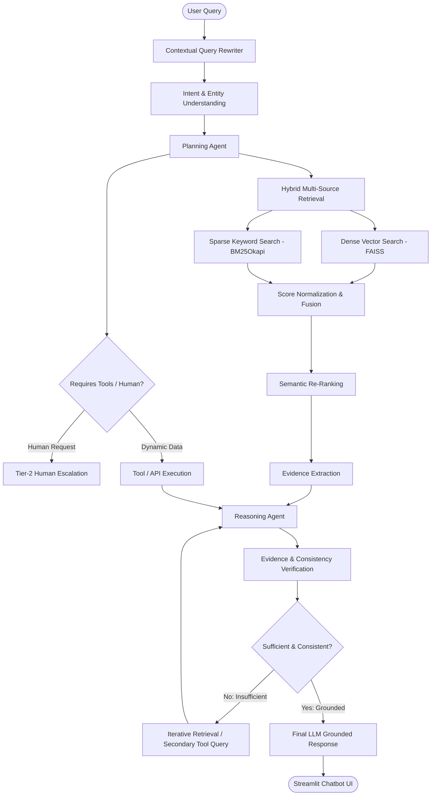

# LLM-Based Customer Support Chatbot Using Transformers, RAG, and Agentic AI

A production-grade, runnable Python and Streamlit prototype demonstrating **Agentic RAG**, **Hybrid Retrieval (Dense FAISS + Sparse BM25)**, **Semantic Re-ranking**, **Multi-Agent Orchestration (Planning, Tools, Reasoning, Verification, Human Escalation)**, and an **Empirical Evaluation Module**.

---

## 🏗️ Architecture Overview



---

## 🚀 Quickstart Guide

### 1. Requirements
Ensure Python 3.10+ is installed. All requirements are listed in `requirements.txt`:
```bash
pip install -r requirements.txt
```

### 2. Run Verification & Test Suite
To run the automated test suite covering all 6 mandatory demo questions and calculating evaluation benchmarks:
```bash
python test_pipeline.py
```

### 3. Launch the Streamlit Web Application
```bash
streamlit run app.py
```
Or if `streamlit` is installed in the user script directory:
```bash
python -m streamlit run app.py
```

---

## 🌟 Key Features

1. **Hybrid Retrieval**: Combines semantic embeddings (`all-MiniLM-L6-v2` via FAISS Inner Product) with lexical matching (`BM25Okapi`), performing score normalization and de-duplication.
2. **Semantic Re-ranking**: Cross-compares query embeddings against top retrieved candidates to rank the most contextually relevant chunks.
3. **Planning Agent**: Deconstructs user intent into logical sub-tasks before retrieving or calling tools.
4. **Dynamic Tool Execution**: Realistic mock CRM and store databases supporting:
   - `get_order_status(order_id)`
   - `get_payment_status(transaction_id)`
   - `get_refund_status(order_id)`
   - `get_delivery_status(order_id)`
   - `get_product_information(product_id)`
   - `create_support_ticket(...)`
   - `request_human_agent(...)`
5. **Evidence Verification & Iterative Retrieval**: Guards against hallucinations by checking factual alignment and detecting missing data before answering.
6. **Contextual Query Rewriting**: Resolves ambiguous follow-up queries using conversational memory.
7. **Dual UI Modes**:
   - **Normal User View**: Clean, professional chatbot interface.
   - **Debug / Demo Agentic Trace**: Real-time display of intent, plan, retrieval sources, re-ranking scores, tools called, verification status, and response latency.
8. **Live Evaluation Benchmark**: Empirical measurement of Precision@K, Recall@K, MRR, Relevance, Groundedness, Task Completion Rate, and Escalation Rate.
